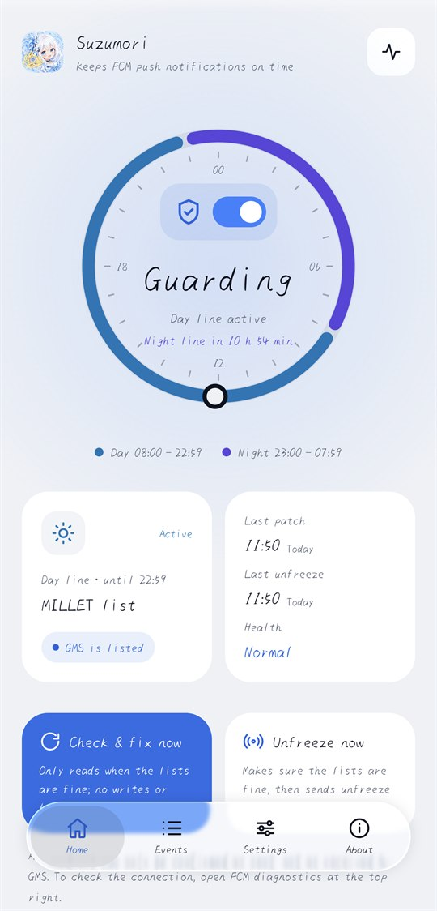
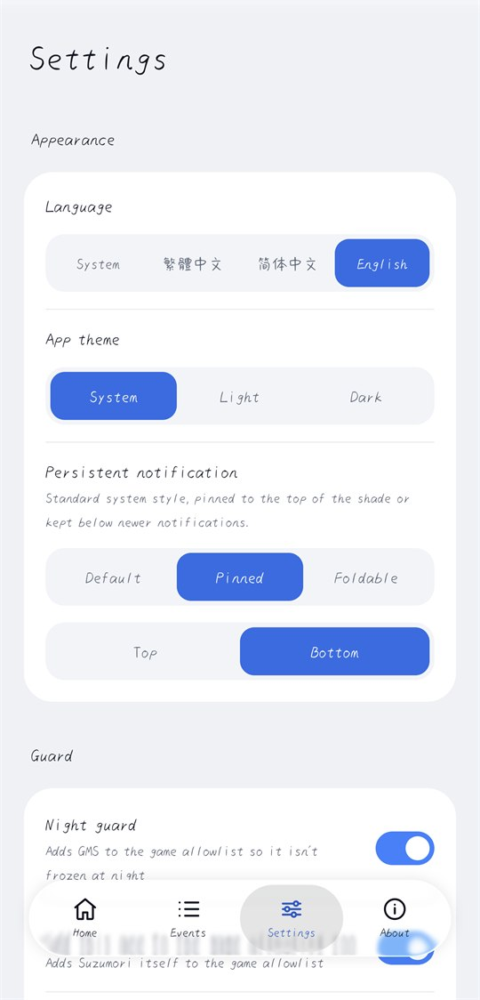
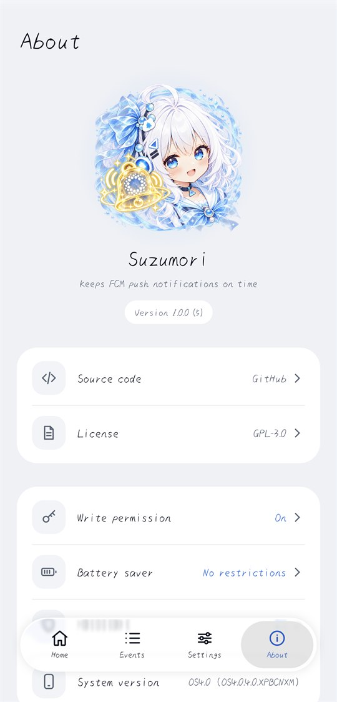

<p align="center">
  
</p>

<h1 align="center">Suzumori</h1>

<p align="center">Keeps Google Play services (GMS) from being frozen on Chinese HyperOS, so FCM push notifications arrive on time.</p>

<p align="center">
  <a href="README.md">繁體中文</a> ・ <a href="README.zh-CN.md">简体中文</a> ・ <b>English</b>
</p>

<p align="center">
  <a href="https://github.com/27161433/Suzumori/releases/latest"></a>
  <a href="https://github.com/27161433/Suzumori/actions/workflows/ci.yml"></a>
  <a href="LICENSE"></a>
  
</p>

No root, Shizuku or permanent ADB needed. Suzumori runs as a normal app and works with developer options turned off.

| Home | Settings | About |
|---|---|---|
|  |  |  |

## Who it's for

- Xiaomi and Redmi phones running the **Chinese (mainland China) build of HyperOS**, with Google Play services installed by the user.
- If notifications from FCM-based apps such as Gmail, Telegram or Discord arrive late, or all at once when you open the app, this is for you.
- Android 13 or later. Tested on a Xiaomi 17 Pro Max with HyperOS OS4.0.4.0.XPBCNXM (Android 17).

Global HyperOS builds don't have this freezing mechanism and don't need Suzumori.

## Features

- **Auto guard**: puts GMS back into the exemption lists as soon as it's removed. Suzumori watches the lists, screen on/off, boot (including before unlock) and app updates, with a fallback check every 15 minutes. The switch is in the dial on the home page.
- **Night guard**: adds GMS (and Suzumori) to the game allowlist, so HyperOS 4 doesn't freeze it at night.
- **Unfreeze & reconnect**: restores the lists, then unfreezes GMS and asks it to reconnect. You can run it from the app or from a quick settings tile.
- **Event log**: keeps the last 2,000 list rewrites, patches and broadcasts, exportable as plain text. Use it to see how often and when PowerKeeper and Joyose rewrite the lists.
- **Self-monitoring**: records whether Suzumori was frozen, why its process was killed, and whether it restarted afterwards.
- **Permission prompts**: if write permission, battery saver or autostart isn't set up, the home page says so and opens the right system page in one tap.
- **Interface**: 繁體中文, 简体中文 and English, plus light and dark themes, all switchable in Settings. The persistent notification can use the default style, a pinned position (top or bottom) or a foldable style.
- **Pre-uninstall cleanup**: removes only the entries Suzumori added.

## Download and install

Download the latest `Suzumori-<version>.apk` from [Releases](https://github.com/27161433/Suzumori/releases/latest).

Since Android 14, AOSP blocks apps with an old targetSdk (24 or lower from Android 15) with `INSTALL_FAILED_DEPRECATED_SDK_VERSION`.
Chinese HyperOS 4 (OS4.0.4.0, Android 17) doesn't enable this block in testing, so the APK installs directly.

1. Try installing the APK on the phone first.
2. If it's blocked, turn on developer options and USB debugging (or wireless debugging) temporarily, then run once on a computer:

   ```
   adb install --bypass-low-target-sdk-block Suzumori-1.0.1.apk
   ```

3. After it's installed you can turn developer options off again. ADB isn't needed after that.

Updates must be signed with the same key as the installed version. Debug builds you compile yourself use a different key from the Releases builds; to switch between them you have to uninstall first, so **clean up before uninstalling** (see below).

Every APK on Releases is signed with the same key. You can check the certificate with `apksigner verify --print-certs`:

```
CN=Suzumori, O=nakisuzu
SHA-256: 70706052f2e2a469afc178304ae36cbbfae6973dab19f8ef8e73e8e36a674339
```

## Setup

1. The first time you open the app, the system shows a long list of permissions (app list, home screen shortcuts, clipboard and so on).
   The system shows this review screen for every legacy app (targetSdk below 23). **Suzumori doesn't request these permissions** and can't skip the screen.
   Leave everything off and tap OK.
2. The system warns that the app was built for an older version of Android. Tap OK; this is also normal for targetSdk 22.
3. If the home page shows "Write permission is off", tap "Turn on", enable "Modify system settings", then come back. HyperOS turns it off by default after installation.
4. If it shows "Battery saver isn't set to “No restrictions”", tap "Open settings". This opens Suzumori's battery saver page directly; choose "No restrictions".
5. If it shows "Autostart is off", tap "Turn on" to open app management and enable "Autostart". Without autostart, Xiaomi doesn't notify Suzumori at boot.
6. When the system asks whether to allow notifications, allow them. The persistent notification is low priority and silent; it lets Suzumori react immediately in the background.
7. You can add the "Unfreeze & reconnect" tile to Control Center to fix delayed notifications in one tap.

The About page shows all three settings at any time; tap one to open its system page.

## Settings

| Where | Option | Default | Description |
|---|---|---|---|
| Home | Auto guard (switch in the dial) | On | When off, Suzumori only checks when you ask it to |
| Settings | Language | System | 繁體中文, 简体中文 or English. You can also change it in the system's per-app language settings |
| Settings | App theme | System | Light or dark |
| Settings | Persistent notification style | Default | Pinned: stays at the top or bottom of the notification shade. Foldable: long-press to fold it into "More notifications" |
| Settings | Night guard | On | Keeps GMS in the game allowlist. Turning it off removes only the entries Suzumori added |
| Settings | Add this app to the game allowlist too | On | At night the "No restrictions" list stops working, so Suzumori can be frozen too, and Joyose may clear the game allowlist overnight. A frozen Suzumori can't restore the lists |
| Settings | Persistent notification | On | Runs as a foreground service. Without it, list changes reached Suzumori about 10 seconds late in testing |

## How it works

Greezer, the freezing mechanism in Chinese HyperOS, freezes GMS soon after the screen turns off, which drops the FCM connection. Suzumori fights it with two of the system's own exemption lists and an unfreeze broadcast.

### `MILLET_NO_RESTRICT_APP`: the day line

- A comma-separated package list in `Settings.System`. Greezer checks it on several freeze paths and doesn't freeze apps in it.
- **The GMS-specific limiter only checks this list.** After the screen turns off, any GMS activity gets it quick-frozen within about 10 seconds. In testing, the game allowlist doesn't stop this path.
- PowerKeeper builds this list from its own database and overwrites the whole string on every rebuild, which drops GMS. Rebuilds happen at boot, when apps are installed or removed, when the user changes any app's battery saver setting, and so on.
- So it can't be set permanently; Suzumori watches for changes and restores it immediately. It keeps every existing entry and only appends GMS when it's missing.

### `com.miui.game.allowlist`: the night line

- From 23:00 to 07:59, with the screen off and the device idle, HyperOS 4 ignores the "No restrictions" list (freeze reason `nightDoze`).
- The game pre-download exemption list (`Settings.System`, underscore-separated) is checked before a `freezeUid` freeze. Apps in it are refused, with no time window. In testing it blocks freezes after the screen turns off.
- The system doesn't read this value at boot; it only loads it when the value changes. So after each boot, Suzumori adds or removes a trailing underscore. The string changes but the members don't, which makes the system reload it.
- Security and Joyose also write this list and sometimes clear it entirely. Suzumori keeps their entries and restores its own when they're cleared.

### Unfreeze and reconnect

- Adding GMS to a list **doesn't unfreeze** it if it's already frozen.
- Unfreeze: send the broadcast `com.xiaomi.mipush.REFRESH_WHITE_LIST_ACTION` to `android` with `pkgName=com.google.android.gms` and `option=-1`. The system unfreezes GMS's UID for the main user; `-1` doesn't change any MiPush list. In testing, Greezer unfroze GMS within the same second when a normal app sent it.
- Reconnect: after about 1.5 seconds, send `GCM_RECONNECT` and `MCS_HEARTBEAT` to GMS.
- Unfreezing alone isn't enough: without GMS in MILLET, it's frozen again 5 to 18 seconds later. So Suzumori always restores the lists before unfreezing.
- Broadcasts are only sent after a patch, on the first check after boot, or when you ask. When the lists are fine, Suzumori only reads them; it doesn't write or broadcast.
- `sendBroadcast()` not throwing only means "sent", not "received". To check whether GMS is really connected, open FCM diagnostics (top right of the home page).

### Staying under control

- All operations run one at a time, so they don't conflict. Suzumori's own writes trigger its watchers, but the next check sees healthy lists and stops, so there's no loop.
- It re-reads the latest value before writing and reads it back afterwards to verify. A failed verification is retried up to 3 times, waiting longer each time.
- At most 10 patches per minute. Beyond that, Suzumori logs it and pauses for 5 minutes, so it can't fight another app forever.

### Can Suzumori itself be frozen?

A normal app can't guarantee it will never be frozen; the system decides. Suzumori uses several layers of protection plus self-monitoring:

| Possible cause | Protection |
|---|---|
| Greezer's background freezing | Suzumori keeps itself in the MILLET list too (even if Xiaomi revokes "No restrictions") |
| HyperOS 4 night freezing | Suzumori adds itself to the game allowlist |
| Android freezing cached background processes | The foreground service keeps the process out of the cached state |
| The process gets killed | Autostart, automatic service restart and the 15-minute fallback check |
| Swiped away from recents | In testing, HyperOS kills the process but recreates the service within about 1 second, so guarding resumes |

The home page's "Health" and the event log record:

- **Paused**: measured with uptime. Uptime doesn't advance while the CPU sleeps, so device sleep isn't mistaken for a pause.
- **Process killed**: the reason comes from the system's `getHistoricalProcessExitReasons`. A restart within 10 seconds counts as healthy.
- **Process started**: the reason comes from the system's `getHistoricalProcessStartReasons` (Android 15 and later), so you can confirm whether it restarted after being killed.

### Why targetSdk is fixed at 22

When a normal app writes a non-public `Settings.System` key, targetSdk 23 and above throws `IllegalArgumentException`. At targetSdk 22 and below, holding `WRITE_SETTINGS` is enough: the system only logs a warning and allows the write. Suzumori's core function depends entirely on this compatibility behavior, so targetSdk **can't be raised**.

## Limitations

- Normal apps can't read the FCM connection state (`/proc/net/tcp` is unreadable since Android 10), so Suzumori can't tell whether GMS is frozen or disconnected. It can only unfreeze and reconnect at known moments.
- There's still a short gap between a list being overwritten and Suzumori restoring it. The system has no atomic update, so racing PowerKeeper, Security and Joyose can't be fully avoided.
- No wake locks or exact alarms. With the screen off and the CPU asleep, waits get longer, and the 15-minute fallback check may be deferred to the system's maintenance window.
- Whether the GMS-specific limiter honors the "No restrictions" list at night hasn't been verified.
- Only the main user is protected. The system only reads the main user's settings, and the unfreeze broadcast only works for the main user, so Second Space isn't covered.
- Suzumori can't disable Greezer's GMS limiter (that needs the DUMP permission), and can't change other apps' autostart or battery saver settings for you.
- Package names containing underscores can't go into the game allowlist.

## Clean up before uninstalling

**Clean up before you uninstall.** Once uninstalled, the app has no chance to clean up, and the entries it left in the game allowlist keep GMS exempt from freezing.

1. At the bottom of the Settings page, tap "Clean up before uninstalling" and confirm.
2. Cleanup stops auto guard and night guard, and removes from the game allowlist **only the entries Suzumori added** (based on the baseline recorded before its first write). Entries from other apps are kept.
3. If nothing is left, it writes an empty string instead of deleting the key. Deleting the key doesn't clear the system's cache, so removed entries would stay protected.
4. When it's done, tap "Uninstall".

`MILLET_NO_RESTRICT_APP` needs no cleanup; PowerKeeper drops GMS the next time it rebuilds the list.

If you already uninstalled without cleaning up, the baseline is gone with the app, so you have to fix it manually over ADB:

```
adb shell settings get system com.miui.game.allowlist
adb shell settings put system com.miui.game.allowlist "<the value without com.google.android.gms and com.nakisuzu.suzumori>"
```

If nothing is left, write an empty string `""`. Don't use `settings delete`.

## Troubleshooting

With USB or wireless debugging on, this shows Suzumori's diagnostics (service lifecycle, what triggered each check and how long it took; no list contents):

```
adb logcat -s Suzumori
```

To see whether the system froze GMS or Suzumori (cleared on reboot):

```
adb shell dumpsys greezer
```

When reporting a problem, please attach the log exported from the top right of the event log page.

## Privacy

- The only permissions are `WRITE_SETTINGS`, `RECEIVE_BOOT_COMPLETED`, `FOREGROUND_SERVICE` and `POST_NOTIFICATIONS`.
- There's no `INTERNET` permission and no analytics, tracking or crash-reporting SDK. All records stay on the phone and only leave it when you export them.

## Building

Requirements: JDK 17 or later and the Android SDK (compileSdk 37).

```
./gradlew testDebugUnitTest     # unit tests
./gradlew lintRelease           # lint
./gradlew assembleDebug         # app/build/outputs/apk/debug/app-debug.apk
./gradlew assembleRelease       # signed only when keystore.properties exists
```

Release signing details go in `keystore.properties` at the project root. It's in `.gitignore`; don't commit it:

```
storeFile=suzumori-release.jks
storePassword=...
keyAlias=suzumori
keyPassword=...
```

### Dependencies

- Only official Google (AndroidX, Jetpack) and JetBrains (Kotlin, kotlinx) libraries, with **one exception** for the UI:
  - [miuix](https://github.com/compose-miuix-ui/miuix) (Apache-2.0): HyperOS-style Compose components, blur effects and icons.
  - Its dependency [MaterialKolor](https://github.com/jordond/materialkolor) (MIT).
- The liquid glass navigation bar (`ui/components/glass/`) is adapted from the miuix v0.9.4 example app (Apache-2.0),
  which is itself adapted from [Kyant0/AndroidLiquidGlass](https://github.com/Kyant0/AndroidLiquidGlass) (Apache-2.0).
  Each file keeps the original copyright and license notice and states what was changed. It's source code, not an extra dependency.

## Contributing

Bug reports and improvements are welcome; please read [CONTRIBUTING.md](CONTRIBUTING.md) first. Report security issues privately as described in [SECURITY.md](SECURITY.md).

## License

Suzumori is released under the [GNU General Public License v3.0](LICENSE). You're free to use, modify and distribute it, but if you distribute a modified version you must also release its source code under GPL-3.0.

- The files in `app/src/main/kotlin/com/nakisuzu/suzumori/ui/components/glass/` are licensed under Apache-2.0; see [THIRD_PARTY_NOTICES.md](THIRD_PARTY_NOTICES.md).
- The app icon and the About page artwork are provided by the project author and released with the project under GPL-3.0.

Suzumori isn't affiliated with Xiaomi or Google. HyperOS and MIUI are trademarks of Xiaomi; Google Play and Firebase Cloud Messaging are trademarks of Google.
