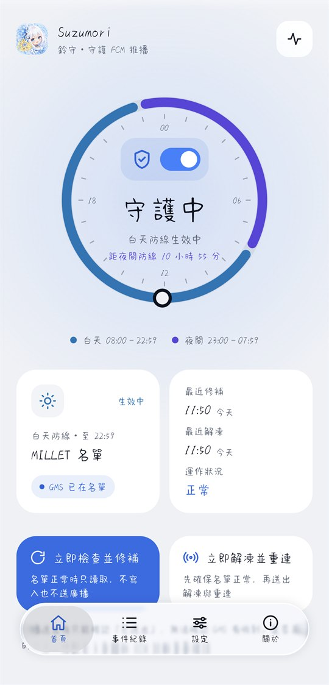
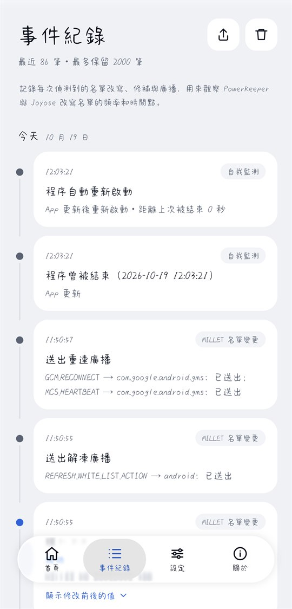
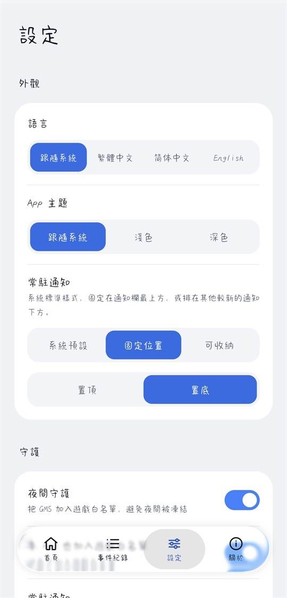
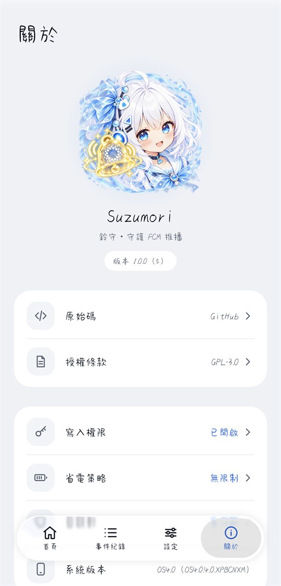

<p align="center">
  
</p>

<h1 align="center">Suzumori（鈴守）</h1>

<p align="center">在陸版 HyperOS 上守護 Google Play 服務（GMS）不被凍結，讓 FCM 推播準時送達。</p>

<p align="center">
  <b>繁體中文</b> ・ <a href="README.zh-CN.md">简体中文</a> ・ <a href="README.en.md">English</a>
</p>

<p align="center">
  <a href="https://github.com/27161433/Suzumori/releases/latest"></a>
  <a href="https://github.com/27161433/Suzumori/actions/workflows/ci.yml"></a>
  <a href="LICENSE"></a>
  
</p>

不需要 root、Shizuku 或常駐 ADB，以一般 App 的身分運作，可以在關閉開發者選項的情況下使用。

| 首頁 | 事件紀錄 | 設定 | 關於 |
|---|---|---|---|
|  |  |  |  |

## 適用對象

- 使用**陸版（中國大陸版）HyperOS** 的小米、Redmi 手機，並自行安裝了 Google Play 服務。
- 常遇到 Gmail、Telegram、Discord 等依賴 FCM 的 App 通知延遲，打開 App 才一次湧進來。
- Android 13 以上。實測環境是 Xiaomi 17 Pro Max、HyperOS OS4.0.4.0.XPBCNXM（Android 17）。

國際版 HyperOS 沒有這個凍結機制，不需要本 App。

## 功能

- **自動守護**：GMS 被移出豁免名單時立即補回。監聽名單變化、螢幕開關、開機（含解鎖前）、App 更新，另外每 15 分鐘保底檢查一次。總開關在首頁的圓環中。
- **夜間守護**：把 GMS（以及本 App）加入遊戲白名單，避免 HyperOS 4 夜間凍結。
- **解凍並重連**：補回名單後解凍 GMS 並請它重新連線。App 內與快速設定磚都可以手動執行。
- **事件紀錄**：保存最近 2000 筆名單改寫、修補與廣播的紀錄，可匯出成純文字，用來觀察 PowerKeeper 與 Joyose 改寫名單的頻率和時間點。
- **自我監測**：記錄本 App 是否曾被凍結、程序被結束的原因，以及被結束後是否自動重新啟動。
- **權限提示**：寫入權限、省電策略、自啟動沒設定好時，首頁直接提示，點一下就到對應的系統頁面。
- **介面**：繁體中文、简体中文、English，以及淺色、深色主題，都可以在設定中切換。常駐通知可選系統預設、固定位置（置頂或置底）或可收納。
- **解除安裝前清理**：只移除本 App 加入的項目。

## 下載與安裝

到 [Releases](https://github.com/27161433/Suzumori/releases/latest) 下載最新的 `Suzumori-<版本>.apk`。

Android 14 起，AOSP 會擋下 targetSdk 過舊的 App（Android 15 起門檻是 24），錯誤是 `INSTALL_FAILED_DEPRECATED_SDK_VERSION`。
實測陸版 HyperOS 4（OS4.0.4.0，Android 17）沒有啟用這個限制，可以直接安裝。

1. 先試著直接在手機上點 APK 安裝。
2. 如果被擋，暫時開啟開發者選項與 USB 偵錯（或無線偵錯），在電腦上執行一次：

   ```
   adb install --bypass-low-target-sdk-block Suzumori-1.0.0.apk
   ```

3. 裝好之後就可以關掉開發者選項，之後不再需要 ADB。

更新版本時，簽章必須和已安裝的版本相同。自行建置的 debug 版與 Releases 上的版本簽章不同，要互換時必須先解除安裝，**解除安裝前請先做清理**（見下方）。

Releases 上的 APK 都以同一把金鑰簽署，可以用 `apksigner verify --print-certs` 確認憑證：

```
CN=Suzumori, O=nakisuzu
SHA-256: 70706052f2e2a469afc178304ae36cbbfae6973dab19f8ef8e73e8e36a674339
```

## 設定步驟

1. 第一次開啟時，系統會先列出一長串權限（取得應用程式清單、桌面捷徑、剪貼簿等）。
   這是系統對所有舊版 App（targetSdk 低於 23）強制顯示的審查畫面，**不是 Suzumori 申請的權限**，App 也無法略過它。
   全部保持關閉，直接按「確定」即可。
2. 系統會提示「此應用程式專為舊版 Android 打造」，按「確定」即可，這同樣是 targetSdk 22 的正常現象。
3. 首頁出現「寫入權限未開啟」時，點「前往開啟」打開「修改系統設定」，再回到 App。HyperOS 安裝後預設是關閉的。
4. 出現「省電策略未設為『無限制』」時，點「前往設定」會直接開啟本 App 的省電策略頁，選「無限制」。
5. 出現「自啟動未開啟」時，點「前往開啟」進入應用管理，開啟「自啟動」。沒有自啟動，小米不會在開機時通知本 App。
6. 系統詢問是否允許通知時，建議允許。常駐通知是低重要性、無聲的，用來讓 Suzumori 在背景即時反應。
7. 可以把「解凍並重連」快速設定磚加到控制中心，推播延遲時一鍵處理。

「關於」頁可以隨時確認這三項設定，點任一項都會開啟對應的系統頁面。

## 設定一覽

| 位置 | 項目 | 預設 | 說明 |
|---|---|---|---|
| 首頁 | 自動守護（圓環中的開關） | 開 | 關閉後只在手動操作時檢查 |
| 設定 | 語言 | 跟隨系統 | 繁體中文、简体中文、English，也可以在系統設定的「App 語言」修改 |
| 設定 | App 主題 | 跟隨系統 | 淺色、深色 |
| 設定 | 常駐通知樣式 | 系統預設 | 固定位置：固定在通知欄最上方或最下方。可收納：長按通知可以收納到「更多通知」 |
| 設定 | 夜間守護 | 開 | 維護遊戲白名單中的 GMS。關閉時只移除本 App 加入的項目 |
| 設定 | 本 App 也加入遊戲白名單 | 開 | 夜間「無限制」名單失效，本 App 也可能被凍結；Joyose 可能在半夜清空遊戲白名單。本 App 被凍結就無法補回名單 |
| 設定 | 常駐通知 | 開 | 以前景服務常駐。實測沒有前景服務時，背景收到名單變化會延後約 10 秒 |

## 運作原理

陸版 HyperOS 的凍結機制（Greezer）會在螢幕關閉後很快凍結 GMS，FCM 連線因此中斷。Suzumori 利用系統本身的兩份豁免名單，以及一個解凍廣播來對抗它。

### `MILLET_NO_RESTRICT_APP`：白天防線

- `Settings.System` 中以逗號分隔的套件名單。Greezer 在多條凍結路徑上會先查這份名單，名單內的 App 不會被凍結。
- **GMS 專用限制器只看這份名單**：螢幕關閉後 GMS 一有活動，約 10 秒就會被快速凍結。實測遊戲白名單擋不住這條路徑。
- 這份名單由 PowerKeeper 從自己的資料庫產生，每次重建都會整串覆寫，把 GMS 洗掉。重建時機包括開機、安裝或移除 App、使用者修改任何 App 的省電策略等。
- 所以它沒辦法永久生效，只能監聽變化、立刻補回。補回時保留所有既有項目，只在 GMS 不存在時追加。

### `com.miui.game.allowlist`：夜間防線

- HyperOS 4 在 23:00 到 07:59、螢幕關閉且裝置 idle 時，會讓「無限制」名單失效（凍結原因標記為 `nightDoze`）。
- 遊戲預下載豁免名單（`Settings.System`，以底線分隔）會在 `freezeUid` 凍結前被檢查，名單內的 App 會被拒絕凍結，而且沒有時段限制。實測可以擋下螢幕關閉後的凍結。
- 系統開機時不會主動讀取這個值，只在值改變時載入。所以每次開機後，Suzumori 會在結尾加上或移除一個底線，讓字串改變、成員不變，觸發系統重新載入。
- 安全中心和 Joyose 也會寫這份名單，有時會整串清空。Suzumori 會保留它們的項目，被清掉時補回。

### 解凍與重連

- 加入名單**不會解凍**已經被凍結的 GMS。
- 解凍：送廣播 `com.xiaomi.mipush.REFRESH_WHITE_LIST_ACTION` 給 `android`，帶 `pkgName=com.google.android.gms`、`option=-1`。系統會解凍 GMS 在主使用者下的 UID，`-1` 不會改動任何 MiPush 名單。實測一般 App 送出後，Greezer 會在同一秒解凍 GMS。
- 重連：等約 1.5 秒後，送 `GCM_RECONNECT` 與 `MCS_HEARTBEAT` 給 GMS。
- 只解凍不夠：MILLET 沒有 GMS 時，解凍後 5 到 18 秒就會被重新凍結。所以 Suzumori 一律先補回名單再解凍。
- 只在有修補、開機後第一次檢查，或使用者手動要求時才送廣播。名單都正常時只讀取，不寫入也不送廣播。
- `sendBroadcast()` 沒有拋出例外只代表「已送出」，不代表對方有收到。是否真的連上，要開 FCM 診斷頁面確認（首頁右上角）。

### 防止失控

- 所有操作依序執行，不會互相衝突。自己的寫入也會觸發監聽，但下一次檢查會讀到正常狀態而結束，不會形成迴圈。
- 寫入前會再讀一次最新值，寫入後讀回驗證；驗證失敗最多重試 3 次，每次重試前等待更久。
- 每分鐘最多修補 10 次，超過時記錄下來並暫停 5 分鐘，避免和其他程式無限互相覆寫。

### Suzumori 自己會不會被凍結

一般 App 無法「絕對」保證不被凍結，凍結的決定權在系統。Suzumori 的做法是多層防護，再加上自我監測：

| 可能的原因 | 防護 |
|---|---|
| Greezer 的背景凍結 | 本 App 也維持在 MILLET 名單中（即使小米取消了「無限制」也一樣） |
| HyperOS 4 的夜間凍結 | 本 App 也加入遊戲白名單 |
| Android 本身凍結背景暫存程序 | 前景服務讓程序不會進入暫存狀態 |
| 程序被殺掉 | 自啟動、服務自動重啟、每 15 分鐘的保底檢查 |
| 從多工畫面滑掉 | 實測 HyperOS 會結束程序，但約 1 秒內就重新建立服務，守護隨即恢復 |

首頁的「運作狀況」與事件紀錄會記下：

- **曾被暫停**：以 uptime 計時判斷。CPU 休眠時 uptime 不會前進，所以裝置休眠不會被誤判。
- **程序被結束**：原因來自系統的 `getHistoricalProcessExitReasons`。被結束後 10 秒內就重新啟動，視為正常。
- **程序啟動**：原因來自系統的 `getHistoricalProcessStartReasons`（Android 15 以上），可以確認被結束後有沒有自動重新啟動。

### 為什麼 targetSdk 固定為 22

一般 App 寫入非公開的 `Settings.System` key 時，targetSdk 23 以上會被拋出 `IllegalArgumentException`；targetSdk 22 以下只要持有 `WRITE_SETTINGS`，系統只記錄警告並允許寫入。Suzumori 的核心功能完全依賴這個相容行為，所以 targetSdk **不能提高**。

## 限制

- 一般 App 讀不到 FCM 連線狀態（Android 10 起讀不到 `/proc/net/tcp`），所以 Suzumori 無法知道 GMS 是否被凍結或連線是否中斷，只能在已知的時機主動解凍和重連。
- 名單被覆寫到 Suzumori 補回之間，仍有短暫的空窗。系統沒有原子操作，和 PowerKeeper、安全中心、Joyose 的競爭無法完全避免。
- 不使用 wake lock 和精確鬧鐘。螢幕關閉、CPU 休眠時，等待時間會被拉長；每 15 分鐘的保底檢查也可能延後到系統的維護時段。
- 夜間時段 GMS 專用限制器是否仍然遵守「無限制」名單，尚未驗證。
- 只保護主使用者。系統只看主使用者的設定值，解凍廣播也只對主使用者有效，分身空間不在範圍內。
- 不能關閉 Greezer 的 GMS 限制器（需要 DUMP 權限），也不能替使用者修改其他 App 的自啟動、省電策略等設定。
- 含有底線的套件名稱無法放進遊戲白名單。

## 解除安裝前的清理

**請在解除安裝之前先清理。** 解除安裝後 App 就沒有機會再執行清理，留在遊戲白名單中的項目會一直讓 GMS 免於凍結。

1. 在「設定」頁最下方按「解除安裝前清理」，確認後執行。
2. 清理會停止自動守護與夜間守護，並從遊戲白名單移除**本 App 當初加入的項目**（依第一次寫入前記錄的基準判斷），其他程式的項目會保留。
3. 沒有剩下任何項目時寫入空字串，不會刪除 key。直接刪除 key 時系統不會清除快取，被移除的項目會繼續受到保護。
4. 完成後可以直接點「前往解除安裝」。

`MILLET_NO_RESTRICT_APP` 不需要清理，PowerKeeper 下次重建名單時會自然移除 GMS。

如果已經解除安裝而沒有清理，基準紀錄會隨解除安裝消失，只能用 ADB 手動修改：

```
adb shell settings get system com.miui.game.allowlist
adb shell settings put system com.miui.game.allowlist "<移除 com.google.android.gms 與 com.nakisuzu.suzumori 之後剩下的值>"
```

沒有剩下項目時寫入空字串 `""`，不要用 `settings delete`。

## 疑難排解

開啟 USB 偵錯或無線偵錯後，可以用以下指令查看 Suzumori 的診斷訊息（服務的生命週期、每次檢查的觸發原因與耗時，不含名單內容）：

```
adb logcat -s Suzumori
```

查看系統是否凍結過 GMS 或本 App（重新開機後紀錄會清空）：

```
adb shell dumpsys greezer
```

回報問題時，請附上事件紀錄頁右上角匯出的紀錄。

## 隱私

- 權限只有 `WRITE_SETTINGS`、`RECEIVE_BOOT_COMPLETED`、`FOREGROUND_SERVICE`、`POST_NOTIFICATIONS`。
- 沒有 `INTERNET` 權限，也沒有任何分析、統計或錯誤回報 SDK。所有紀錄都只存在手機上，只有你自己匯出時才會離開手機。

## 建置

需求：JDK 17 以上、Android SDK（compileSdk 37）。

```
./gradlew testDebugUnitTest     # 單元測試
./gradlew lintRelease           # lint
./gradlew assembleDebug         # app/build/outputs/apk/debug/app-debug.apk
./gradlew assembleRelease       # 需要 keystore.properties 才會簽章
```

release 簽章資訊放在專案根目錄的 `keystore.properties`（已列入 `.gitignore`，不要提交）：

```
storeFile=suzumori-release.jks
storePassword=...
keyAlias=suzumori
keyPassword=...
```

### 依賴

- 只使用 Google（AndroidX、Jetpack）與 JetBrains（Kotlin、kotlinx）官方的函式庫，**唯一的例外**是介面：
  - [miuix](https://github.com/compose-miuix-ui/miuix)（Apache-2.0）：HyperOS 風格的 Compose 元件、毛玻璃效果與圖示。
  - 它所依賴的 [MaterialKolor](https://github.com/jordond/materialkolor)（MIT）。
- 底部的液態玻璃導覽列（`ui/components/glass/`）改寫自 miuix v0.9.4 範例 App 的原始碼（Apache-2.0），
  該範例又改編自 [Kyant0/AndroidLiquidGlass](https://github.com/Kyant0/AndroidLiquidGlass)（Apache-2.0）。
  檔案開頭保留原作者的版權與授權標示，並註明修改處。不是額外的依賴套件。

## 參與貢獻

歡迎回報問題與提出改進，請先看 [CONTRIBUTING.md](CONTRIBUTING.md)。安全性問題請依 [SECURITY.md](SECURITY.md) 私下回報。

## 授權

Suzumori 以 [GNU General Public License v3.0](LICENSE) 釋出：你可以自由使用、修改與散布，但散布修改後的版本時必須同樣以 GPL-3.0 公開原始碼。

- `app/src/main/kotlin/com/nakisuzu/suzumori/ui/components/glass/` 中的檔案以 Apache-2.0 授權，見 [THIRD_PARTY_NOTICES.md](THIRD_PARTY_NOTICES.md)。
- App 圖示與關於頁插畫由專案作者提供，隨本專案以 GPL-3.0 釋出。

Suzumori 與小米、Google 沒有任何關係。HyperOS、MIUI 是小米的商標，Google Play、Firebase Cloud Messaging 是 Google 的商標。
