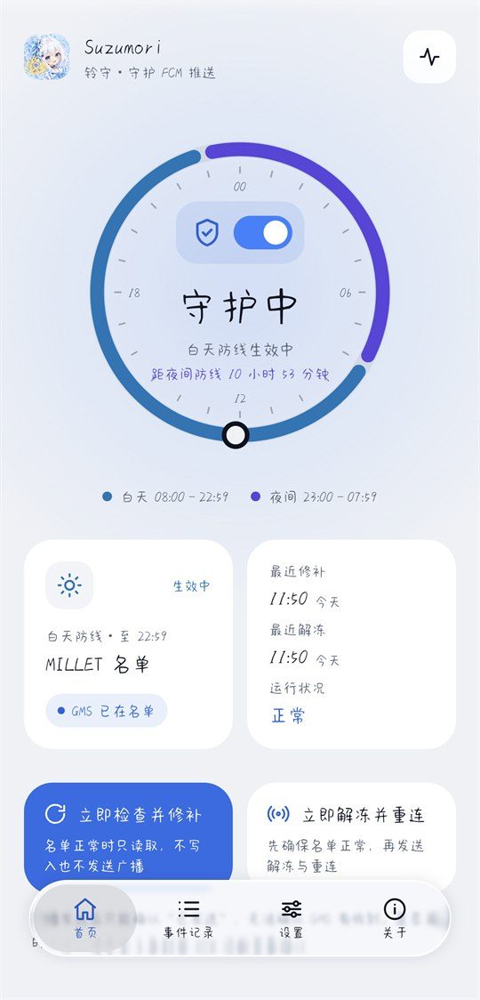
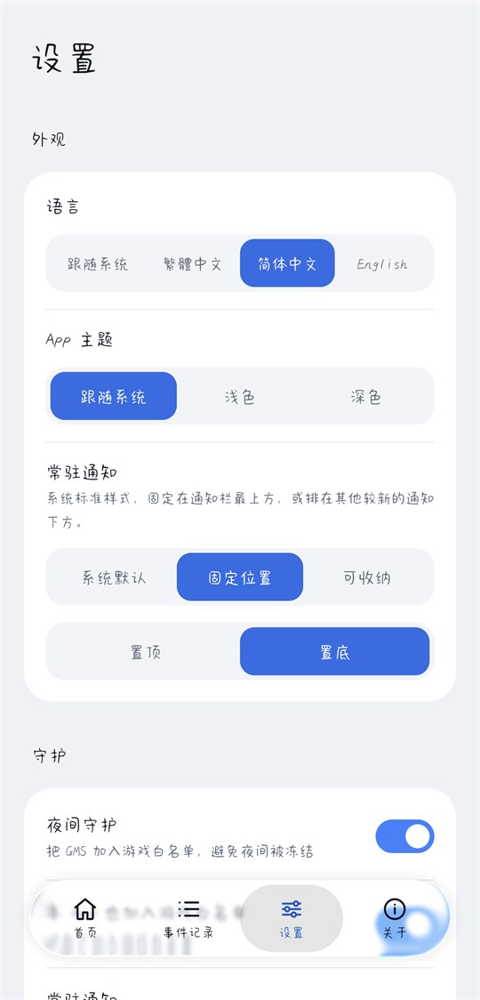
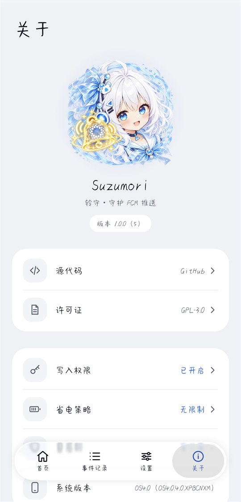

<p align="center">
  
</p>

<h1 align="center">Suzumori（铃守）</h1>

<p align="center">在国行 HyperOS 上守护 Google Play 服务（GMS）不被冻结，让 FCM 推送准时送达。</p>

<p align="center">
  <a href="README.md">繁體中文</a> ・ <b>简体中文</b> ・ <a href="README.en.md">English</a>
</p>

<p align="center">
  <a href="https://github.com/27161433/Suzumori/releases/latest"></a>
  <a href="https://github.com/27161433/Suzumori/actions/workflows/ci.yml"></a>
  <a href="LICENSE"></a>
  
</p>

不需要 root、Shizuku 或常驻 ADB，以普通 App 的身份运行，可以在关闭开发者选项的情况下使用。

| 首页 | 设置 | 关于 |
|---|---|---|
|  |  |  |

## 适用对象

- 使用**国行（中国大陆版）HyperOS** 的小米、Redmi 手机，并自行安装了 Google Play 服务。
- 经常遇到 Gmail、Telegram、Discord 等依赖 FCM 的 App 通知延迟，打开 App 才一次性收到。
- Android 13 及以上。实测环境是 Xiaomi 17 Pro Max、HyperOS OS4.0.4.0.XPBCNXM（Android 17）。

国际版 HyperOS 没有这个冻结机制，不需要本 App。

## 功能

- **自动守护**：GMS 被移出豁免名单时立即补回。监听名单变化、屏幕亮灭、开机（含解锁前）、App 更新，另外每 15 分钟兜底检查一次。总开关在首页的圆环中。
- **夜间守护**：把 GMS（以及本 App）加入游戏白名单，避免 HyperOS 4 夜间冻结。
- **解冻并重连**：补回名单后解冻 GMS 并请它重新连接。App 内与快捷开关都可以手动执行。
- **事件记录**：保存最近 2000 条名单改写、修补与广播的记录，可导出成纯文本，用来观察 PowerKeeper 与 Joyose 改写名单的频率和时间点。
- **自我监测**：记录本 App 是否曾被冻结、进程被结束的原因，以及被结束后是否自动重新启动。
- **权限提示**：写入权限、省电策略、自启动没设置好时，首页直接提示，点一下就到对应的系统页面。
- **界面**：繁體中文、简体中文、English，以及浅色、深色主题，都可以在设置中切换。常驻通知可选系统默认、固定位置（置顶或置底）或可收纳。
- **FCM App 检查**：列出手机上使用 FCM 的 App，以及它们的自启动与省电策略，点一下就到该 App 的设置页。某个 App 推送延迟时用来找原因，只读取、不修改。
- **检查更新**：打开 App 时与每天一次向 GitHub 查询新版本，有新版本时通知，点开就能看到更新内容与下载链接。可以在设置中关闭。
- **卸载前清理**：只移除本 App 加入的项目。

## 下载与安装

到 [Releases](https://github.com/27161433/Suzumori/releases/latest) 下载最新的 `Suzumori-<版本>.apk`。

Android 14 起，AOSP 会拦截 targetSdk 过旧的 App（Android 15 起门槛是 24），错误是 `INSTALL_FAILED_DEPRECATED_SDK_VERSION`。
实测国行 HyperOS 4（OS4.0.4.0，Android 17）没有启用这个限制，可以直接安装。

1. 先试着直接在手机上点 APK 安装。
2. 如果被拦截，暂时开启开发者选项与 USB 调试（或无线调试），在电脑上执行一次：

   ```
   adb install --bypass-low-target-sdk-block Suzumori-1.0.1.apk
   ```

3. 装好之后就可以关闭开发者选项，之后不再需要 ADB。

更新版本时，签名必须和已安装的版本相同。自行编译的 debug 版与 Releases 上的版本签名不同，要互换时必须先卸载，**卸载前请先清理**（见下方）。

Releases 上的 APK 都用同一把密钥签名，可以用 `apksigner verify --print-certs` 确认证书：

```
CN=Suzumori, O=nakisuzu
SHA-256: 70706052f2e2a469afc178304ae36cbbfae6973dab19f8ef8e73e8e36a674339
```

## 设置步骤

1. 第一次打开时，系统会先列出一长串权限（获取应用列表、桌面快捷方式、剪贴板等）。
   这是系统对所有旧版 App（targetSdk 低于 23）强制显示的审查界面，**不是 Suzumori 申请的权限**，App 也无法跳过它。
   全部保持关闭，直接点“确定”即可。
2. 系统会提示“此应用专为旧版 Android 打造”，点“确定”即可，这同样是 targetSdk 22 的正常现象。
3. 首页出现“写入权限未开启”时，点“前往开启”打开“修改系统设置”，再回到 App。HyperOS 安装后默认是关闭的。
4. 出现“省电策略未设为‘无限制’”时，点“前往设置”会直接打开本 App 的省电策略页，选“无限制”。
5. 出现“自启动未开启”时，点“前往开启”进入应用管理，开启“自启动”。没有自启动，小米不会在开机时通知本 App。
6. 系统询问是否允许通知时，建议允许。常驻通知是低重要性、静音的，用来让 Suzumori 在后台实时响应。
7. 可以把“解冻并重连”快捷开关加到控制中心，推送延迟时一键处理。

“关于”页可以随时确认这三项设置，点任一项都会打开对应的系统页面。

## 设置一览

| 位置 | 项目 | 默认 | 说明 |
|---|---|---|---|
| 首页 | 自动守护（圆环中的开关） | 开 | 关闭后只在手动操作时检查 |
| 设置 | 语言 | 跟随系统 | 繁體中文、简体中文、English，也可以在系统设置的“应用语言”修改 |
| 设置 | App 主题 | 跟随系统 | 浅色、深色 |
| 设置 | 常驻通知样式 | 系统默认 | 固定位置：固定在通知栏最上方或最下方。可收纳：长按通知可以收纳到“更多通知” |
| 设置 | 夜间守护 | 开 | 维护游戏白名单中的 GMS。关闭时只移除本 App 加入的项目 |
| 设置 | 本 App 也加入游戏白名单 | 开 | 夜间“无限制”名单失效，本 App 也可能被冻结；Joyose 可能在半夜清空游戏白名单。本 App 被冻结就无法补回名单 |
| 设置 | 常驻通知 | 开 | 显示常驻通知，以前台服务运行。关闭后仍会在后台监听名单变化，但系统比较容易暂停没有通知的服务，反应可能变慢 |
| 设置 | 自动检查更新 | 开 | 打开 App 时与每天一次向 GitHub 查询新版本，有新版本时发出通知 |

## 工作原理

国行 HyperOS 的冻结机制（Greezer）会在熄屏后很快冻结 GMS，FCM 连接因此中断。Suzumori 利用系统本身的两份豁免名单，以及一个解冻广播来对抗它。

### `MILLET_NO_RESTRICT_APP`：白天防线

- `Settings.System` 中以逗号分隔的包名名单。Greezer 在多条冻结路径上会先查这份名单，名单内的 App 不会被冻结。
- **GMS 专用限制器只看这份名单**：熄屏后 GMS 一有活动，约 10 秒就会被快速冻结。实测游戏白名单挡不住这条路径。
- 这份名单由 PowerKeeper 从自己的数据库生成，每次重建都会整串覆写，把 GMS 洗掉。重建时机包括开机、安装或卸载 App、用户修改任何 App 的省电策略等。
- 所以它没办法永久生效，只能监听变化、立刻补回。补回时保留所有已有项目，只在 GMS 不存在时追加。

### `com.miui.game.allowlist`：夜间防线

- HyperOS 4 在 23:00 到 07:59、熄屏且设备 idle 时，会让“无限制”名单失效（冻结原因标记为 `nightDoze`）。
- 游戏预下载豁免名单（`Settings.System`，以下划线分隔）会在 `freezeUid` 冻结前被检查，名单内的 App 会被拒绝冻结，而且没有时段限制。实测可以挡下熄屏后的冻结。
- 系统开机时不会主动读取这个值，只在值改变时加载。所以每次开机后，Suzumori 会在结尾加上或移除一个下划线，让字符串改变、成员不变，触发系统重新加载。
- 安全中心和 Joyose 也会写这份名单，有时会整串清空。Suzumori 会保留它们的项目，被清掉时补回。

### 解冻与重连

- 加入名单**不会解冻**已经被冻结的 GMS。
- 解冻：发送广播 `com.xiaomi.mipush.REFRESH_WHITE_LIST_ACTION` 给 `android`，带 `pkgName=com.google.android.gms`、`option=-1`。系统会解冻 GMS 在主用户下的 UID，`-1` 不会改动任何 MiPush 名单。实测普通 App 发送后，Greezer 会在同一秒解冻 GMS。
- 重连：等约 1.5 秒后，发送 `GCM_RECONNECT` 与 `MCS_HEARTBEAT` 给 GMS。
- 只解冻不够：MILLET 没有 GMS 时，解冻后 5 到 18 秒就会被重新冻结。所以 Suzumori 一律先补回名单再解冻。
- 只在有修补、开机后第一次检查，或用户手动要求时才发送广播。名单都正常时只读取，不写入也不发送广播。
- `sendBroadcast()` 没有抛出异常只代表“已发送”，不代表对方有收到。是否真的连上，要打开 FCM 诊断页面确认（首页右上角）。

### 防止失控

- 所有操作依次执行，不会互相冲突。自己的写入也会触发监听，但下一次检查会读到正常状态而结束，不会形成循环。
- 写入前会再读一次最新值，写入后读回验证；验证失败最多重试 3 次，每次重试前等待更久。
- 每分钟最多修补 10 次，超过时记录下来并暂停 5 分钟，避免和其他程序无限互相覆写。

### Suzumori 自己会不会被冻结

普通 App 无法“绝对”保证不被冻结，冻结的决定权在系统。Suzumori 的做法是多层防护，再加上自我监测：

| 可能的原因 | 防护 |
|---|---|
| Greezer 的后台冻结 | 本 App 也维持在 MILLET 名单中（即使小米取消了“无限制”也一样） |
| HyperOS 4 的夜间冻结 | 本 App 也加入游戏白名单 |
| Android 本身冻结后台缓存进程 | 常驻的服务让进程不会进入缓存状态；开启常驻通知时是前台服务，更不容易被暂停 |
| 进程被杀掉 | 自启动、服务自动重启、每 15 分钟的兜底检查 |
| 从最近任务划掉 | 实测 HyperOS 会结束进程，但约 1 秒内就重新创建服务，守护随即恢复 |

首页的“运行状况”与事件记录会记下：

- **曾被暂停**：以 uptime 计时判断。CPU 休眠时 uptime 不会前进，所以设备休眠不会被误判。
- **进程被结束**：原因来自系统的 `getHistoricalProcessExitReasons`。被结束后 10 秒内就重新启动，视为正常。
- **进程启动**：原因来自系统的 `getHistoricalProcessStartReasons`（Android 15 及以上），可以确认被结束后有没有自动重新启动。

### 为什么 targetSdk 固定为 22

普通 App 写入非公开的 `Settings.System` key 时，targetSdk 23 及以上会被抛出 `IllegalArgumentException`；targetSdk 22 及以下只要持有 `WRITE_SETTINGS`，系统只记录警告并允许写入。Suzumori 的核心功能完全依赖这个兼容行为，所以 targetSdk **不能提高**。

## 限制

- 普通 App 读不到 FCM 连接状态（Android 10 起读不到 `/proc/net/tcp`），所以 Suzumori 无法知道 GMS 是否被冻结或连接是否中断，只能在已知的时机主动解冻和重连。
- 名单被覆写到 Suzumori 补回之间，仍有短暂的空窗。系统没有原子操作，和 PowerKeeper、安全中心、Joyose 的竞争无法完全避免。
- 不使用 wake lock 和精确闹钟。熄屏、CPU 休眠时，等待时间会被拉长；每 15 分钟的兜底检查也可能延后到系统的维护时段。
- 夜间时段 GMS 专用限制器是否仍然遵守“无限制”名单，尚未验证。
- 只保护主用户。系统只看主用户的设置值，解冻广播也只对主用户有效，分身空间不在范围内。
- 不能关闭 Greezer 的 GMS 限制器（需要 DUMP 权限），也不能替用户修改其他 App 的自启动、省电策略等设置。
- 包含下划线的包名无法放进游戏白名单。
- FCM App 检查只看得到自启动与省电策略。App 自己的通知设置、勿扰模式等不在范围内；自启动用的是小米未公开的代码，读不到时显示“无法判断”。

## 卸载前清理

**请在卸载之前先清理。** 卸载后 App 就没有机会再执行清理，留在游戏白名单中的项目会一直让 GMS 免于冻结。

1. 在“设置”页最下方点“卸载前清理”，确认后执行。
2. 清理会停止自动守护与夜间守护，并从游戏白名单移除**本 App 当初加入的项目**（根据第一次写入前记录的基准判断），其他程序的项目会保留。
3. 没有剩下任何项目时写入空字符串，不会删除 key。直接删除 key 时系统不会清除缓存，被移除的项目会继续受到保护。
4. 完成后可以直接点“前往卸载”。

`MILLET_NO_RESTRICT_APP` 不需要清理，PowerKeeper 下次重建名单时会自然移除 GMS。

如果已经卸载而没有清理，基准记录会随卸载消失，只能用 ADB 手动修改：

```
adb shell settings get system com.miui.game.allowlist
adb shell settings put system com.miui.game.allowlist "<移除 com.google.android.gms 与 com.nakisuzu.suzumori 之后剩下的值>"
```

没有剩下项目时写入空字符串 `""`，不要用 `settings delete`。

## 疑难排解

开启 USB 调试或无线调试后，可以用以下命令查看 Suzumori 的诊断信息（服务的生命周期、每次检查的触发原因与耗时，不含名单内容）：

```
adb logcat -s Suzumori
```

查看系统是否冻结过 GMS 或本 App（重启后记录会清空）：

```
adb shell dumpsys greezer
```

反馈问题时，请附上事件记录页右上角导出的记录。

## 隐私

- 权限只有 `INTERNET`、`WRITE_SETTINGS`、`RECEIVE_BOOT_COMPLETED`、`FOREGROUND_SERVICE`、`POST_NOTIFICATIONS`。
- 网络只用来向 GitHub（`api.github.com`）查询新版本，不会发送任何个人数据。在设置中关闭“自动检查更新”后，只有你在更新页点“重新检查”时才会联网。
- FCM App 检查只在你打开那一页或刷新时，在手机上读取已安装 App 的设置。不会上传、不会修改，也不写进事件记录，不需要额外的权限。
- 没有任何分析、统计或错误上报 SDK。所有记录都只保存在手机上，只有你自己导出时才会离开手机。

## 编译

需求：JDK 17 及以上、Android SDK（compileSdk 37）。

```
./gradlew testDebugUnitTest     # 单元测试
./gradlew lintRelease           # lint
./gradlew assembleDebug         # app/build/outputs/apk/debug/app-debug.apk
./gradlew assembleRelease       # 需要 keystore.properties 才会签名
```

release 签名信息放在项目根目录的 `keystore.properties`（已加入 `.gitignore`，不要提交）：

```
storeFile=suzumori-release.jks
storePassword=...
keyAlias=suzumori
keyPassword=...
```

### 依赖

- 只使用 Google（AndroidX、Jetpack）与 JetBrains（Kotlin、kotlinx）官方的库，**唯一的例外**是界面：
  - [miuix](https://github.com/compose-miuix-ui/miuix)（Apache-2.0）：HyperOS 风格的 Compose 组件、毛玻璃效果与图标。
  - 它所依赖的 [MaterialKolor](https://github.com/jordond/materialkolor)（MIT）。
- 底部的液态玻璃导航栏（`ui/components/glass/`）改写自 miuix v0.9.4 示例 App 的源代码（Apache-2.0），
  该示例又改编自 [Kyant0/AndroidLiquidGlass](https://github.com/Kyant0/AndroidLiquidGlass)（Apache-2.0）。
  文件开头保留原作者的版权与许可声明，并注明修改处。不是额外的依赖。

## 参与贡献

欢迎反馈问题与提出改进，请先看 [CONTRIBUTING.md](CONTRIBUTING.md)。安全问题请按 [SECURITY.md](SECURITY.md) 私下报告。

## 许可证

Suzumori 以 [GNU General Public License v3.0](LICENSE) 发布：你可以自由使用、修改与分发，但分发修改后的版本时必须同样以 GPL-3.0 公开源代码。

- `app/src/main/kotlin/com/nakisuzu/suzumori/ui/components/glass/` 中的文件以 Apache-2.0 许可，见 [THIRD_PARTY_NOTICES.md](THIRD_PARTY_NOTICES.md)。
- App 图标与关于页插画由项目作者提供，随本项目以 GPL-3.0 发布。

Suzumori 与小米、Google 没有任何关系。HyperOS、MIUI 是小米的商标，Google Play、Firebase Cloud Messaging 是 Google 的商标。
